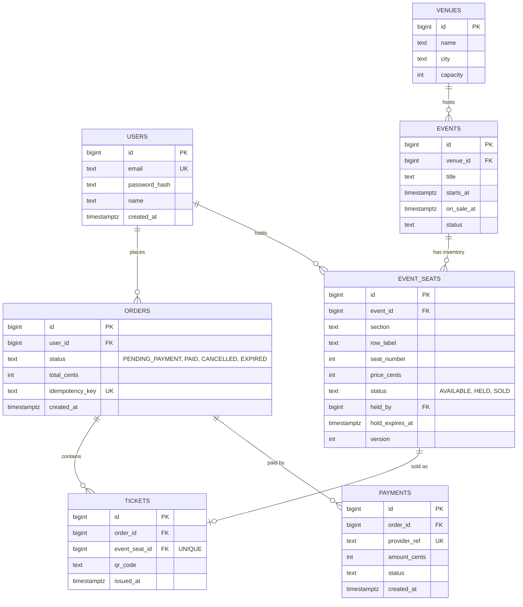
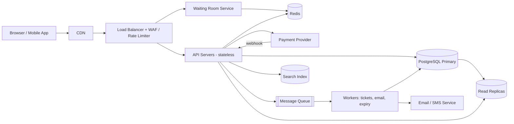

# TicketHub: System Design Document

TicketHub is a website that sells tickets for concerts and events. This document follows the six-part framework: (1) requirements, (2) estimates, (3) API, (4) data model, (5) architecture, (6) trade-offs. It also explains, in a dedicated section, how the design guarantees that two people can never buy the same seat.

**Given facts**

| Fact | Value |
|---|---|
| Registered users | 2,000,000 |
| Daily visitors (normal day) | 50,000 |
| Pages viewed per visitor | 10 |
| Tickets sold (normal day) | 5,000 |
| Hot sale | 200,000 people compete for 20,000 seats in the first 10 minutes |

---

## 1. Requirements

### 1.1 Functional requirements

1. A user can register, log in and manage a profile.
2. A user can browse and search events by name, artist, city and date.
3. A user can view an event page with a live seat map showing which seats are available.
4. A user can select seats; the system **temporarily holds** them (5 minutes) while the user pays.
5. A user can pay for held seats and receive a confirmed order with a ticket (QR code) by email and in their account.
6. A user can view order history and cancel/refund according to event policy.
7. An admin/organizer can create events, define seat inventory and prices, and set the on-sale time.
8. Held seats that are not paid for are released automatically when the hold expires.

### 1.2 Non-functional requirements

| Requirement | Target |
|---|---|
| **Correctness (most important)** | A seat is never sold to two people. No double-selling, ever. |
| Availability | 99.9% for browsing; 99.95% for the checkout path |
| Latency | Browsing p95 < 300 ms; seat hold p95 < 500 ms |
| Scalability | Handle a 10-minute spike of 200,000 users (about 10x oversubscribed) without crashing |
| Fairness | Users are served roughly first-come-first-served during a hot sale |
| Durability | A paid order is never lost (replicated database, backups) |
| Security | HTTPS everywhere, hashed passwords, PCI compliance via a third-party payment provider (we never store card numbers) |
| Observability | Metrics, logs, and alerts on error rate, queue length, hold-expiry rate |

---

## 2. Estimates

### 2.1 Normal day

- Page views: 50,000 visitors x 10 pages = **500,000 page views/day**.
- Average rate: 500,000 / 86,400 s = **about 6 requests/second**.
- Peak (assume 10x the average, evening traffic): **about 60 requests/second**.
- Tickets: 5,000/day = **about 0.06 purchases/second** on average. Even if concentrated in 4 hours it is only about 0.35/s.
- Read-to-write ratio: 500,000 page views vs 5,000 purchases = **100:1**, so the system is heavily read-dominated and caching helps a lot.

**Storage**

- Users: 2,000,000 x about 1 KB = **about 2 GB**.
- Tickets: 5,000/day x 365 = 1.8 million/year x about 0.5 KB = **about 1 GB/year** (orders and payments add roughly the same).
- Seats: an event with 20,000 seats x about 100 bytes = 2 MB. With 500 active events that is **about 1 GB**.
- Total: a few GB per year, which fits comfortably on a single primary relational database. Storage is not the bottleneck; **concurrency** is.

### 2.2 Hot sale (very popular concert)

- 200,000 users try to buy 20,000 seats in 10 minutes (600 s).
- Arrival rate: 200,000 / 600 = **about 333 new users/second**, versus about 6/s normally. That is **about 55x the normal rate**.
- Oversubscription: 200,000 / 20,000 = **10 users per seat**; 90% of users will not get a ticket.
- If each user makes about 5 requests (event page, seat map, hold, pay, confirm): 333 x 5 = **about 1,700 requests/second** sustained.
- Seat-hold attempts: assume 3 attempts per user because contested seats fail: 200,000 x 3 / 600 = **about 1,000 hold attempts/second**, all on the **same 20,000 rows**. This is the hot spot.
- Successful sales needed: 20,000 / 600 = **about 33 purchases/second** (so the payment provider load is small).
- Seat-map polling danger: if every user polled the seat map every 5 s, that is 200,000 / 5 = **40,000 requests/second**. We avoid this by serving the map from cache/CDN with a 1-2 s TTL (about 1 DB read per second per event) and pushing changes via SSE/WebSocket.
- Design target: **5,000 requests/second** with headroom (about 3x the estimated peak).

---

## 3. API

REST over HTTPS, JSON, bearer token (JWT) authentication. All write endpoints that create money or inventory effects accept an `Idempotency-Key` header so retries are safe.

| # | Method and path | Purpose | Auth |
|---|---|---|---|
| 1 | `POST /v1/auth/register` | Create an account | No |
| 2 | `POST /v1/auth/login` | Return a JWT | No |
| 3 | `GET /v1/events?query=&city=&date=&page=` | Search/list events (cached) | No |
| 4 | `GET /v1/events/{eventId}` | Event details, venue, price tiers | No |
| 5 | `GET /v1/events/{eventId}/seats` | Seat map with status (available/held/sold); cached 1-2 s | No |
| 6 | `POST /v1/events/{eventId}/holds` | Hold selected seats for 5 minutes | Yes |
| 7 | `DELETE /v1/holds/{holdId}` | Release a hold early | Yes |
| 8 | `POST /v1/orders` | Convert a hold into an order and start payment | Yes |
| 9 | `POST /v1/payments/webhook` | Payment provider callback; confirms payment | Signature |
| 10 | `GET /v1/orders/{orderId}` | Order status and tickets | Yes |
| 11 | `GET /v1/me/orders` | Order history | Yes |
| 12 | `POST /v1/orders/{orderId}/cancel` | Cancel/refund | Yes |
| 13 | `POST /v1/admin/events` | Create event and seat inventory | Admin |
| 14 | `POST /v1/events/{eventId}/queue` | Join the virtual waiting room (hot sales) | Yes |

**Key examples**

`POST /v1/events/42/holds`
```json
// Request
{ "seatIds": [1001, 1002] }

// 201 Created
{ "holdId": "h_8f3a", "seatIds": [1001, 1002], "expiresAt": "2026-10-18T19:05:00Z" }

// 409 Conflict (someone else got there first)
{ "error": "SEAT_UNAVAILABLE", "unavailableSeatIds": [1002] }
```

`POST /v1/orders` (header `Idempotency-Key: 7c1e...`)
```json
// Request
{ "holdId": "h_8f3a", "paymentMethodToken": "tok_abc" }

// 202 Accepted
{ "orderId": "o_551", "status": "PENDING_PAYMENT" }
```

---

## 4. Data Model

PostgreSQL (relational) is the source of truth, because seat inventory needs ACID transactions and constraints.



**Relationships**

- A **venue** hosts many **events** (1:N).
- An **event** has many **event_seats** (1:N); one row per physical seat per event (20,000 rows for the hot concert).
- A **user** places many **orders** (1:N).
- An **order** contains many **tickets** (1:N) and has one or more **payments** (1:N, retries are allowed).
- An **event_seat** is sold as **at most one ticket** (1:0..1), enforced by a `UNIQUE` constraint.

**Important indexes**

- `event_seats (event_id, status)` for seat-map queries.
- `event_seats (hold_expires_at) WHERE status = 'HELD'` for the expiry sweeper.
- `orders (user_id, created_at DESC)` for order history.
- `UNIQUE tickets (event_seat_id)` and `UNIQUE orders (idempotency_key)` for correctness.

---

## 5. Architecture



### Component explanations

| Component | Responsibility | Why it is needed |
|---|---|---|
| **CDN** | Serves static assets (JS, images) and caches public event pages | Removes most read traffic from our servers; essential for the 55x spike |
| **Load balancer + WAF + rate limiter** | Spreads traffic across API servers, blocks bots, limits requests per user/IP | Prevents scalpers and scripts from taking all seats; protects the backend |
| **Waiting Room Service** | During a hot sale, places users in a virtual queue and lets them in at a controlled rate (for example 500 users/second) | Turns a 200,000-user burst into a steady flow the database can handle, and gives fairness |
| **API servers (stateless)** | Implement the endpoints in section 3 | Stateless, so we can add more servers (horizontal scaling) during peaks |
| **Redis** | (a) Cache for event pages and seat map; (b) fast atomic seat locks `SET seatlock:{event}:{seat} {userId} NX EX 300`; (c) waiting-room queue; (d) rate-limit counters | Handles thousands of operations/second with sub-millisecond latency and shields the database |
| **PostgreSQL primary** | Source of truth for users, seats, orders, tickets and payments; enforces constraints and transactions | Strong consistency is required to prevent double-selling |
| **Read replicas** | Serve search, history and seat-map reads | Offload reads (100:1 read-to-write ratio) |
| **Message queue** (Kafka/SQS) | Asynchronous jobs: issue tickets, send email, process refunds | Keeps the checkout path fast and retries failures |
| **Workers** | Consume queue messages; run the **hold-expiry sweeper** that frees expired holds | Decouples slow work; guarantees abandoned seats return to inventory |
| **Payment provider** | Charges the card and calls our webhook | We never handle card data (PCI scope is reduced) |
| **Search index** (Elasticsearch/OpenSearch) | Full-text and filtered event search | Fast search without loading the main DB |
| **Email/SMS service** | Sends confirmations and tickets | Standard third-party service |

### Purchase flow

1. The user joins the waiting room (hot sales only) and gets admitted.
2. The user loads the seat map (from cache, at most 1-2 s old).
3. The user selects seats -> `POST /holds` -> seats are locked atomically (section 5.1).
4. The user pays -> `POST /orders` -> the payment provider charges the card.
5. The provider calls the webhook -> the API marks the order `PAID`, sets seats `SOLD`, and creates the tickets in **one transaction**.
6. A worker emails the tickets. If payment fails or time runs out, the hold expires and the seats are released.

### 5.1 How the design prevents two people from buying the same seat

Correctness comes from **three independent layers**. Even if one layer fails, a later one still stops a double sale.

**Layer 1: Atomic hold in Redis (fast gate).**
When a user selects a seat, the API runs one atomic Redis command:

```
SET seatlock:42:1001 user_77 NX EX 300
```

`NX` means "set only if the key does not exist". Redis is single-threaded for commands, so if 1,000 users send this command at the same instant, **exactly one gets `OK`**; the others get `nil` and receive `409 SEAT_UNAVAILABLE` immediately. The `EX 300` expiry means a crashed or abandoned user cannot lock the seat forever. For multiple seats, we acquire all locks (in sorted seat-ID order to avoid deadlocks) and release the ones already acquired if any fails.

**Layer 2: Conditional update in PostgreSQL (source of truth).**
After the Redis lock succeeds, the API writes the hold to the database using a single atomic, conditional statement:

```sql
UPDATE event_seats
SET    status = 'HELD',
       held_by = :user_id,
       hold_expires_at = now() + interval '5 minutes',
       version = version + 1
WHERE  id = :seat_id
  AND  event_id = :event_id
  AND (status = 'AVAILABLE'
       OR (status = 'HELD' AND hold_expires_at < now()));
-- If rows affected = 1 -> we own the seat.
-- If rows affected = 0 -> someone else owns it; roll back and return 409.
```

The check and the write happen in **one statement**, so there is no gap between "is it free?" and "take it" (no check-then-act race). PostgreSQL row-level locking serializes concurrent updates to the same row. The loser sees 0 rows affected.

**Layer 3: Database constraint at purchase time (last line of defense).**
When payment is confirmed, the confirmation runs in a single transaction:

```sql
BEGIN;

-- Only the holder, with an unexpired hold, can complete the sale
UPDATE event_seats
SET    status = 'SOLD'
WHERE  id = :seat_id
  AND  status = 'HELD'
  AND  held_by = :user_id
  AND  hold_expires_at > now();      -- must affect exactly 1 row per seat

INSERT INTO tickets (order_id, event_seat_id, qr_code)
VALUES (:order_id, :seat_id, :qr);   -- UNIQUE (event_seat_id)

UPDATE orders SET status = 'PAID' WHERE id = :order_id;

COMMIT;
```

`tickets.event_seat_id` has a **`UNIQUE` constraint**. Even if a software bug, a retry, or a Redis failure let two requests reach this point, the database physically rejects the second insert and the transaction rolls back. The second buyer's payment is automatically refunded.

**Additional protections**

- **Idempotency keys** on `POST /orders` and the webhook: a double click or retried webhook cannot create two orders or two tickets.
- **Hold expiry edge case:** if payment succeeds after the hold expired and someone else took the seat, the `UPDATE ... hold_expires_at > now()` affects 0 rows; the transaction rolls back and the payment is refunded automatically. To make this rare, the hold time (5 min) is longer than the payment timeout (4 min).
- **Redis failure:** if Redis loses data, Layers 2 and 3 still guarantee correctness; only performance degrades.
- **Sweeper worker** runs every 30 s: `UPDATE event_seats SET status='AVAILABLE', held_by=NULL WHERE status='HELD' AND hold_expires_at < now();`
- **Waiting room and rate limits** reduce contention, so far fewer requests reach the contested rows.

**Why this works under the hot-sale load:** only about 1,000 hold attempts/second reach Redis (well within its capacity of 100,000+ ops/second); only the winners (at most about 33/second, plus brief retries) reach PostgreSQL; and each statement touches one row, so lock time is milliseconds.

**Test plan (to verify the guarantee):** run a concurrency test with 1,000 parallel threads requesting the same seat and assert that exactly 1 succeeds, 999 receive 409, and `SELECT count(*) FROM tickets WHERE event_seat_id = X` equals 1.

---

## 6. Trade-offs

### Trade-off 1: Pessimistic/atomic locking (holds) vs. optimistic "buy-at-the-end"

- **Chosen:** temporary seat holds (5 minutes) with atomic locks.
- **Alternative:** let everyone pick seats freely and only check availability at payment time (optimistic).
- **Why chosen:** with 10 users per seat, optimistic checking would make most users pay attention and enter card details only to be told "sold out", which is a terrible experience and causes many refunds.
- **Cost:** holds can be abused (bots hoarding seats) and can temporarily block real buyers if people abandon checkout. We mitigate with short expiry, per-user hold limits (for example, 6 seats), and rate limiting. Some seats are briefly unavailable even though no one buys them.

### Trade-off 2: Virtual waiting room (fairness and stability) vs. letting everyone in (simplicity and speed)

- **Chosen:** a queue that admits about 500 users/second during hot sales.
- **Why chosen:** it prevents a 55x spike from overwhelming the database and gives a clear, fair experience.
- **Cost:** extra component to build and run; users wait (up to about 7 minutes for the last users); the queue itself must be highly available. For normal events we skip it to keep things simple.

### Trade-off 3: Eventually consistent, cached seat map vs. always-fresh data

- **Chosen:** the seat map is cached for 1-2 seconds, updated via push.
- **Why chosen:** serving 200,000 users directly from the database would need tens of thousands of reads/second; caching reduces that to about 1 read/second per event.
- **Cost:** a user may click a seat that was just taken and get a 409. This is acceptable because **correctness is enforced at hold time, not display time**; the UI simply refreshes and shows the seat as taken.

### Trade-off 4: Relational database (PostgreSQL) vs. NoSQL

- **Chosen:** PostgreSQL with Redis in front.
- **Why chosen:** transactions, foreign keys and `UNIQUE` constraints directly provide the no-double-sale guarantee. Our data is small (a few GB/year), so a single primary with replicas is enough.
- **Cost:** write scaling is limited to a single primary. At our scale (about 33 sales/second at peak) this is fine. If we grew 100x, we would shard by `event_id`, since events are independent.


---

## Summary

| Framework step | Covered in |
|---|---|
| Requirements | Section 1 |
| Estimates (normal and hot sale) | Section 2 |
| API (14 endpoints) | Section 3 |
| Data model (7 tables, relationships and ER diagram) | Section 4 |
| Architecture diagram and component explanations | Section 5 |
| No double-selling guarantee | Section 5.1 |
| Trade-offs (4) | Section 6 |